## 目录

- [[#§1 修订追踪表]]
- [[#§2 背景与目标]]
- [[#§3 功能清单]]
- [[#§4 功能细节规格]]
- [[#§5 功能流程图]]
- [[#§6 功能结构图]]
- [[#§7 页面设计]]
- [[#§8 Corner Case]]
- [[#§9 验收清单]]

## 本文件使用说明

- 本文件合并现有USDT充值、手动调整余额两份PRD及其附录，补齐截至本次对话确认的商户端、管理端最新需求。
- 按用户要求，角色、权限、系统串接、验收与待确认事项全部纳入本文件，无需另读附录文件。
- 本文件为后续统一维护入口；原分项文档保留作历史参考，若有差异以本文件为准。
- “原型已实现”仅代表本地或静态网页交互，不表示真实支付、防护、认证或跨端数据同步已接入。
- 产品业务规则与实现状态分开描述；建议和待确认事项不视为已获得业务批准。

## §1 修订追踪表

| 版本 | 日期 | 作者 | 说明 |
|---|---|---|---|
| V1 | 2026-10-26 | Codex | 合并初稿（未送审） |

## §2 背景与目标

- 商户完成注册登录、上传APP、选购防护套餐、充值和查询；管理员维护商户、应用归属、套餐和资金调整。
- 充值通过蓝盛订单处理，提交币种与到账币种均为USDT；不采用人民币充值方案。
- 上传时填写包名称并选择安装包；生成链接由后台提供，未提供前展示生成中。
- 目标：商户能理解应用与资金状态，管理端能维护配置并追溯余额变动。
- 本期交付为可交互原型与需求文档；正式接口联调、权限认证、实际上传、防护执行与自动扣款不在当前实现范围。
- 上线前必须完成本文件列出的待接入项及全部适用验收。

## §3 功能清单

| 页面 | 端 | 变更 | 范围 |
|---|---|---|---|
| P1 登录与注册 | 商户端 | [NEW] | 账号、密码、二次确认、验证码、注册及登录切换、退出登录 |
| P2 APP列表与任务状态 | 商户端 | [MOD] | 任务信息、包名称、套餐类型、套餐详情、自动续费、任务状态、生成链接、操作 |
| P3 上传安装包 | 商户端 | [MOD] | 包名称、安装包、保存及关闭 |
| P4 生成链接 | 商户端及管理端协作 | [MOD] | 生成链接展示、打开与复制 |
| P5 开通服务与服务详情 | 商户端 | [MOD] | 账户及APP信息、套餐、费用、结果及详情 |
| P6 自动续费规则 | 商户端 | [MOD] | 规则弹窗、最大化与关闭 |
| P7 USDT充值 | 商户端 | [MOD] | 当前余额、充值金额、订单处理中、结果展示与原型控制 |
| P8 充值记录与余额记录 | 商户端 | [MOD] | 余额卡片、充值查询、余额流水查询、分页 |
| P9 商户信息与阿里云信息 | 管理端 | [MOD] | 新增、编辑、详情、启停及阿里云字段 |
| P10 手动调整余额与调整记录 | 管理端 | [NEW] | 增加或扣减、原因、预览、二次确认、只读调整记录 |
| P11 应用包管理与商户归属 | 管理端 | [MOD] | 应用包信息、所属商户、编辑与归属查询 |
| P12 商户充值订单 | 管理端 | [MOD] | 按订单及商户查询、详情与状态 |
| P13 防护套餐设置与商户展示 | 管理端及商户端 | [MOD] | 套餐新增编辑、启停、排序、推荐、权益及价格展示 |
| P14 安全设置与修改密码 | 商户端 | [MOD] | 谷歌验证码绑定展示、登录方式、Telegram入口、密码表单 |

- [MOD]页面旧版参考：[商户端原型](https://bala-luoluo.github.io/M3/merchant/index.html#/login)、[管理端原型](https://bala-luoluo.github.io/M3/admin.html#merchants)。在线页面会随发布更新，并非冻结的旧版本截图。

## §4 功能细节规格

### 4.1 P1 登录与注册

- 登录页默认填入演示账号 admin、演示密码 123456；注册页不预填。该账号仅用于演示，正式系统不得使用共享默认凭据。
- 注册账号为6至20位字母或数字；密码为6至20位字母、数字或英文符号；两次密码一致，验证码正确才允许提交。
- admin 为演示登录例外；重复注册按账号不区分大小写拦截。
- 登录成功进入 APP 列表；退出登录后回到登录页；未登录时显示登录入口。
- 验证码可点击刷新；原型验证码仅为演示，不具备真实人机校验能力。
- 正向：注册成功后登录，显示当前账号并进入商户端。
- 异常：账号密码错误、重复账号、验证码错误、密码不一致时提示且不登录。
- 边界：刷新保持当前浏览器会话；多账号业务数据隔离尚未实现，不能将原型视作独立商户环境。

### 4.2 P2 APP列表与任务状态

- 包名称为独立列，显示上传时填写的名称；任务信息同时显示标识、应用大小和添加时间。
- 任务状态采用：已上传、运行中、流量耗尽、防护过期、暂停；筛选项与列表一致。
- 已上传：已有包记录但未开通套餐；开通成功后显示运行中。
- 流量耗尽：无剩余可用流量；防护过期：套餐有效期已结束；暂停：服务被暂停。
- 原型已有状态展示及判定，尚无真实流量扣减、暂停操作和自动状态任务；同时命中多个条件时正式优先级待确认。
- 支持按标识、套餐类型、任务状态及到期日期筛选；未开通或永久套餐没有到期日期，不匹配有界到期日期筛选。
- 自动续费默认显示未开启；开通前显示“开通服务”，开通后显示“服务详情”。
- 正向：上传后可查对应记录，开通后显示套餐和运行状态。
- 异常：无匹配结果展示空态；开始日期晚于结束日期时提示。
- 边界：删除本地记录需确认；刷新保持记录；商户端任务状态不得与管理端加固任务状态混为一谈。

### 4.3 P3 上传安装包

- 必填包名称，去除首尾空格后1至20字；必选非空 APK 安装包。
- 保存成功后生成应用标识，保留用户填写的包名称、原文件名、大小及添加时间。
- 初始任务状态为已上传，未开通套餐；生成链接显示“生成中”。
- 原型仅检查文件名和大小，不上传文件、不解析图标、应用版本或内部名称；包名称不是自动解析的应用名称。
- IOS轻应用仍为筹备中；当前可操作路径仅支持APK，历史提示提及其他格式不代表已支持。
- 正向：填写名称并选择安装包后保存，列表新增一条记录。
- 异常：名称为空、超长、未选文件、非APK或空文件时不保存并提示。
- 边界：包名称重名暂不拦截，以标识区分；同一文件重复上传与生产文件大小限制待确认。

### 4.4 P4 生成链接

- 生成链接由后台添加，商户上传后不得自行生成下载地址。
- 后台未添加链接时统一显示“生成中”，不显示空链接或复制按钮。
- 后台提供有效链接后显示链接，可打开及复制；复制失败时提示手动复制。
- 不单独展示“生成状态”列；生成中仅是链接占位，不表示真实构建任务已启动。
- 商户端链接与套餐开通状态相互独立；套餐开通不会自动产生链接。
- 正向：后台保存可用链接后，商户端显示该应用链接。
- 异常：无效链接不得成为可点击入口；应用归属错误时禁止串到其他商户。
- 边界：后台链接录入入口、应用对应关系及跨端同步尚未实现；当前只有商户端展示逻辑，原型无真实下载服务。

### 4.5 P5 开通服务与服务详情

- 开通弹窗展示当前余额、应用标识及大小，选择防护套餐，实时展示套餐总费用。
- 套餐读取后台启用配置；停用套餐不可新选。已开通应用保存开通时套餐快照，后续修改套餐不追改已开通详情。
- 套餐配置及展示移除流量包、赠送流量、APK推送分发、默认渠道、多渠道及渠道统计；开通时无对应选项或附加费用。
- 余额不足时阻止开通；无启用套餐时提示后台配置，禁止确认。
- 本地确认后保存套餐名称、开通时间、到期时间及套餐费用。
- 列表显示运行中，“开通服务”变为“服务详情”；自动续费仍未开启。
- 正向：选择合法配置且余额足够，保存开通状态，刷新后仍可看详情。
- 异常：应用已删除或保存失败时提示，不显示成功。
- 边界：原型开通不扣款、不执行真实防护；正式套餐购买的扣款、流水及服务生效一致性待实现。历史快照中的旧附加项不再展示，原有记录金额不追溯改写。

### 4.6 P6 自动续费规则

- 点击“自动续费”展示规则弹窗。
- 展示：到期前3天开始扣款；每次续费30天；提前人工续费后按最新到期时间处理；每日22:00自动检测。
- 上述规则来自参考截图，仅为规则展示，不代表已存在自动扣款任务。
- 正向：打开后完整显示四条规则，支持最大化及关闭。
- 异常：无应用时也可查看规则，不能因此启用自动续费。
- 边界：永久套餐、暂停应用、余额不足、时区及补扣政策待确认。

### 4.7 P7 USDT充值

- 向蓝盛提交的充值币种为USDT，成功到账币种也为USDT，不进行人民币换算。
- 金额必填、大于零、最多两位小数；原型单次最高1,000,000 USDT，正式额度待确认。
- 点击创建充值订单后展示平台订单号、金额、币种、创建时间和处理中；未确认成功前余额不变。
- 正式业务：平台向蓝盛请求订单，核验成功结果后按原平台订单金额入账；结果未知继续处理中，不因等待时间而自动成功。
- 成功后显示到账时间，可继续充值或查看记录；失败不入账，重新充值创建新订单。
- 正向：提交→处理中→可信成功结果→余额增加并写入一条流水。
- 异常：金额错误不下单；失败不入账；通知金额、币种或归属不一致时正式系统拦截并排查。
- 边界：重复成功通知不能重复入账；刷新保留未完成订单；原型仅用折叠控制模拟蓝盛成功与失败，没有真实接口请求或收银台。
- 历史待支付、已取消记录保留，不将其批量改为成功。

### 4.8 P8 充值记录与余额记录

- 两个页面顶部均显示账户当前余额，单位USDT。
- 充值记录显示会员、平台订单号、状态、输入金额、充值金额、创建时间、入账时间、充值币种及到账币种；两侧币种均为USDT。
- 支持订单号和创建时间筛选、重置及每页十条分页；未到账订单无到账时间。
- 余额记录展示会员、类型、金额、流量、调整前余额、调整后余额、标识、描述和时间；按标识查询并分页。
- 正向：成功充值可在订单和余额记录找到一致金额、订单标识与前后余额。
- 异常：失败或处理中订单不生成入账流水；日期不合法时提示。
- 边界：无数据或无匹配结果展示空态；管理端手动调整与商户端余额流水尚未联通。

### 4.9 P9 商户信息与阿里云信息

- 商户ID自动生成；商户名称、登录账号必填；联系人、Telegram、备注可填；新商户初始余额为零。
- 登录账号不能重复，比较时不区分大小写；登记账号不代表创建真实认证凭据。
- 新增六项阿里云信息：阿里云主账号、阿里云密码、阿里云主账号邮箱、阿里云邮箱密码、keyid、keysecret。
- 这六项目前均选填；邮箱填写时检查邮箱格式；新增、编辑及详情可查看对应信息。
- 密码、邮箱密码和keysecret默认掩码；编辑时可切换显示；详情只显示掩码或未设置。
- 正向：保存后列表和详情可查看；刷新保留商户信息。
- 异常：必填缺失或重复账号不保存；无权限访问凭据信息应由正式系统拦截。
- 边界：当前仅限模拟信息，字段隐藏不等于安全存储；正式权限、凭据保护与审计待接入。

### 4.10 P10 手动调整余额与调整记录

- 商户列表新增“调整余额”“调整记录”；弹窗只读展示名称、编号、账号及当前USDT余额。
- 默认增加余额，可切换扣减；金额与原因必填。金额大于零、最多两位小数，单次最高1,000,000 USDT；正式额度待确认。
- 原因去除首尾空格后不能为空，最多200字。禁止扣成负余额，允许恰好扣到零。
- 输入时预览调整后余额；首次确定进入核对，展示调整前后金额、方向及数额，再点击确认调整才保存。
- 修改任意输入后必须重新核对；取消、关闭或Esc退出不保存。
- 成功同时更新商户余额并生成调整流水；手动调整不生成充值订单、不改变既有充值订单。
- 流水按商户及时间倒序展示，包含时间、类型、金额、前后余额、原因、操作人；记录只读。
- 正向：增加或扣减成功后刷新列表并可查看记录。
- 异常：非法金额、空原因、超额扣减阻止保存；余额变化时重新读取并核对；保存失败不提示成功。
- 边界：重复提交只生效一次；正式系统保证余额和流水同成同败。原型不具备真实并发控制，操作人固定为管理员（演示）。

### 4.11 P11 应用包管理与商户归属

- 创建或编辑应用包时关联所属商户，应用名称、原始APK地址、加固项目名为必填；其他既有配置按原型保留。
- 列表显示所属商户；商户详情可跳转查看其应用或充值订单。
- 停用商户不可建立新归属；既有应用保留原归属，变更所属商户需明确确认。
- 正向：保存应用与商户关系，按商户筛选可查。
- 异常：商户缺失、必填不全或无效归属不保存。
- 边界：历史未关联应用显示未关联；应用归属变更不迁移历史充值订单。
- 当前管理端样例应用与商户端上传记录独立；真实上传同步、生成链接录入和发布均待接入。

### 4.12 P12 商户充值订单

- 列表支持订单号、商户、状态、时间筛选；详情展示商户、金额、状态、创建及到账时间。
- 当前管理端保留原有TRC-20演示数据和字段；商户端新蓝盛订单尚未同步至此。
- 正式目标：按平台订单关联蓝盛订单及结果，管理端可核对USDT金额、到账结果和异常原因（待接入）。
- 正向：查询授权商户订单并查看详情。
- 异常：非法日期提示，找不到结果时空态。
- 边界：此页不提供修改订单金额或人工入账；手动调整余额单独留痕。

### 4.13 P13 防护套餐设置与商户展示

- 设置套餐名称、USDT价格、防护周期、排序、状态、推荐、权益和适用说明。
- 名称不能为空或重复；价格最多两位小数，允许零，原型上限1,000,000 USDT；防护周期为零表示永久。
- 排序为非负整数；新增套餐默认停用。
- 总后台套餐列表及新增、编辑表单均移除赠送流量、流量有效期、默认渠道数；相关校验一并删除，旧配置读写时清理这些参数。保留套餐名称、价格、防护周期、排序、状态、推荐、其余权益和适用说明。
- 仅启用套餐在商户端展示，排序值越小越靠前；推荐标记由配置决定；停用后不再提供新选择。
- 正向：后台保存后同浏览器的商户展示更新。
- 异常：非法金额、数量或重复名称不保存；全部停用时商户端展示暂无套餐。
- 边界：已开通套餐信息按快照保留；原型初始零价格不是正式定价，永久名称与配置天数可能不一致，必须以正式配置核对。

### 4.14 P14 安全设置与修改密码

- 保留安全设置页面、谷歌验证码绑定弹窗及修改密码原型。
- 原型使用演示二维码及本地交互，不应作为真实谷歌验证绑定或真实认证变更。
- 正向：可查看安全设置及进入对应表单。
- 异常：未提供真实业务的入口应明确提示，不能伪装绑定成功。
- 边界：登录注册、密码变更与真实账号认证尚未贯通；正式绑定、解绑、验证和恢复政策待确认。

## §5 功能流程图

### 5.1 P1 登录与注册

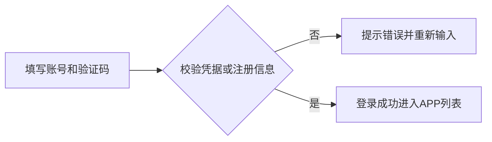

### 5.2 P2 APP列表与任务状态


### 5.3 P3 上传安装包


### 5.4 P4 生成链接


### 5.5 P5 开通服务与服务详情

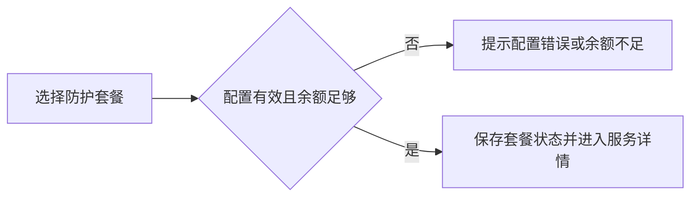

### 5.6 P6 自动续费规则

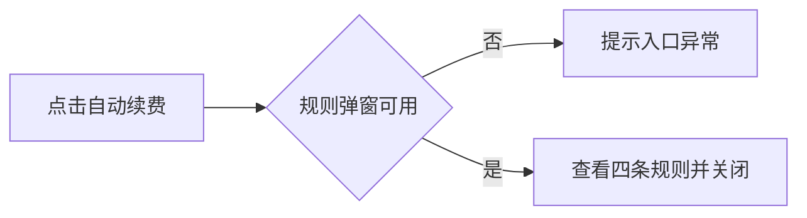

### 5.7 P7 USDT充值

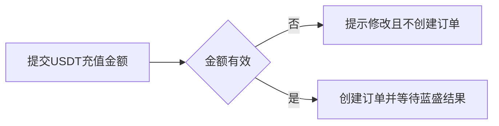

### 5.8 P8 充值记录与余额记录


### 5.9 P9 商户信息与阿里云信息

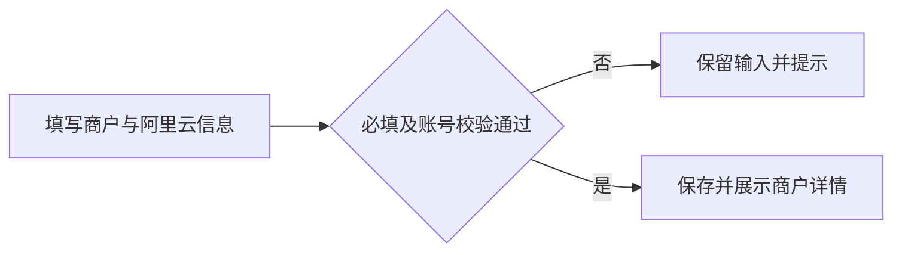

### 5.10 P10 手动调整余额与调整记录


### 5.11 P11 应用包管理与商户归属

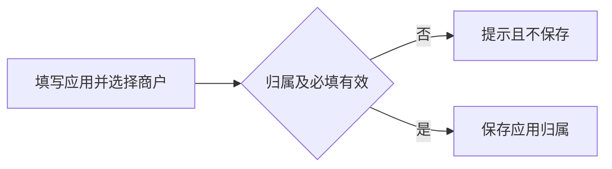

### 5.12 P12 商户充值订单


### 5.13 P13 防护套餐设置与商户展示

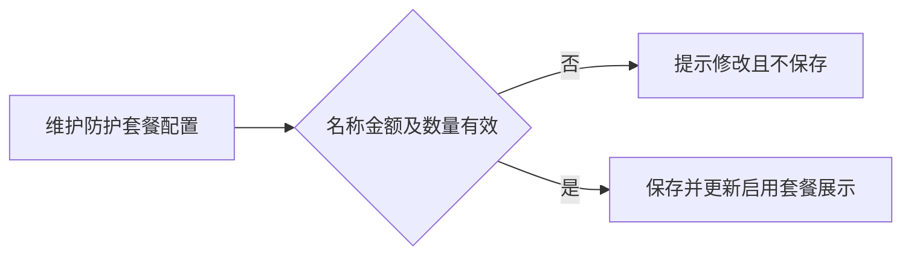

### 5.14 P14 安全设置与修改密码

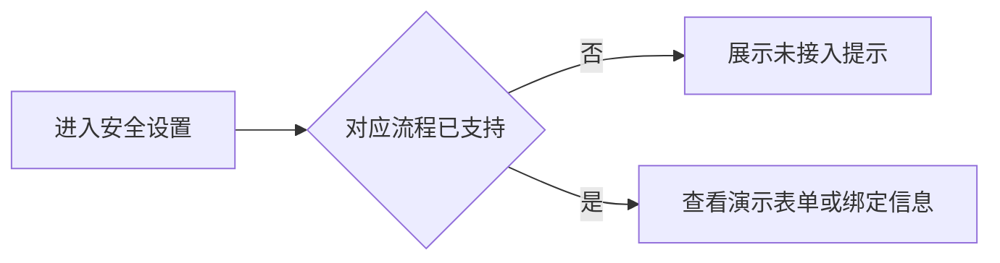

### 充值结果状态

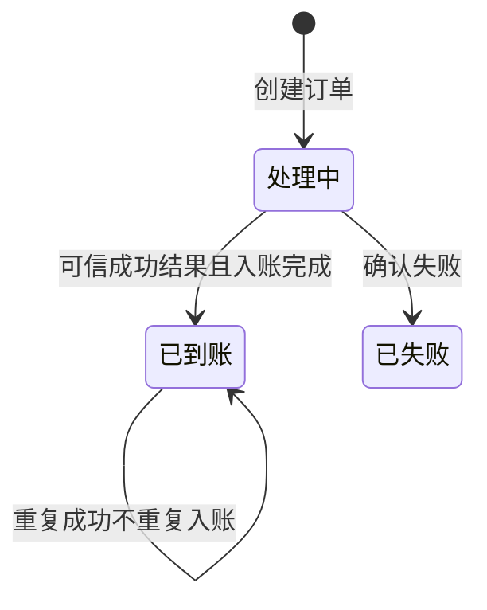

### 余额调整交互状态

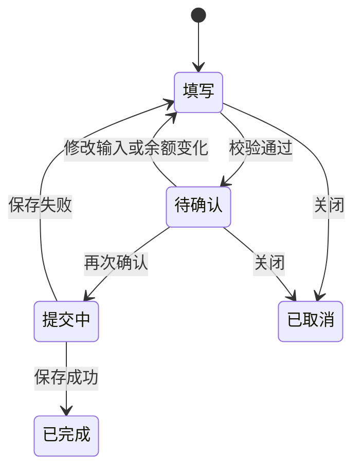

### APP任务状态（恢复路径为正式业务建议）

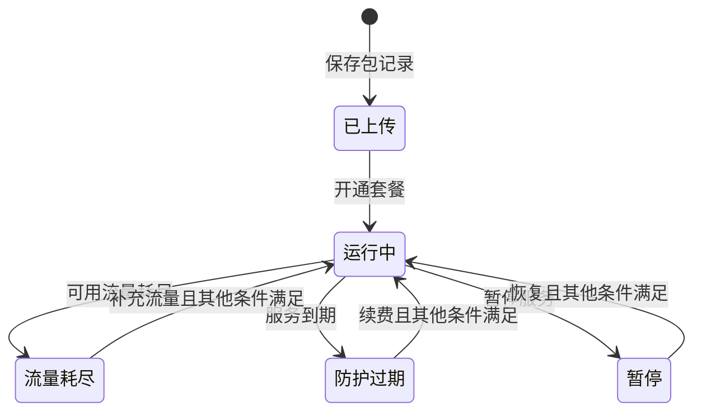

- 暂停、流量补充、续费及恢复操作尚未实现；多个阻断条件同时成立时的优先级见待确认事项。

## §6 功能结构图

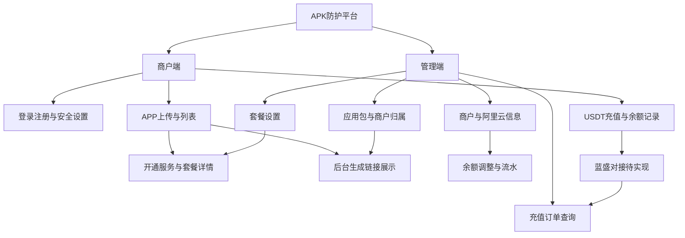

## §7 页面设计

| 页面 | 主要区域 | 关键交互 |
|---|---|---|
| P1 登录与注册 | 账号、密码、二次确认、验证码、注册及登录切换、退出登录 | 详见4.1及5.1；错误就地反馈，空数据展示空态 |
| P2 APP列表与任务状态 | 任务信息、包名称、套餐类型、套餐详情、自动续费、任务状态、生成链接、操作 | 详见4.2及5.2；错误就地反馈，空数据展示空态 |
| P3 上传安装包 | 包名称、安装包、保存及关闭 | 详见4.3及5.3；错误就地反馈，空数据展示空态 |
| P4 生成链接 | 生成链接展示、打开与复制 | 详见4.4及5.4；错误就地反馈，空数据展示空态 |
| P5 开通服务与服务详情 | 账户及APP信息、套餐、费用、结果及详情 | 详见4.5及5.5；错误就地反馈，空数据展示空态 |
| P6 自动续费规则 | 规则弹窗、最大化与关闭 | 详见4.6及5.6；错误就地反馈，空数据展示空态 |
| P7 USDT充值 | 当前余额、充值金额、订单处理中、结果展示与原型控制 | 详见4.7及5.7；错误就地反馈，空数据展示空态 |
| P8 充值记录与余额记录 | 余额卡片、充值查询、余额流水查询、分页 | 详见4.8及5.8；错误就地反馈，空数据展示空态 |
| P9 商户信息与阿里云信息 | 新增、编辑、详情、启停及阿里云字段 | 详见4.9及5.9；错误就地反馈，空数据展示空态 |
| P10 手动调整余额与调整记录 | 增加或扣减、原因、预览、二次确认、只读调整记录 | 详见4.10及5.10；错误就地反馈，空数据展示空态 |
| P11 应用包管理与商户归属 | 应用包信息、所属商户、编辑与归属查询 | 详见4.11及5.11；错误就地反馈，空数据展示空态 |
| P12 商户充值订单 | 按订单及商户查询、详情与状态 | 详见4.12及5.12；错误就地反馈，空数据展示空态 |
| P13 防护套餐设置与商户展示 | 套餐新增编辑、启停、排序、推荐、权益及价格展示 | 详见4.13及5.13；错误就地反馈，空数据展示空态 |
| P14 安全设置与修改密码 | 谷歌验证码绑定展示、登录方式、Telegram入口、密码表单 | 详见4.14及5.14；错误就地反馈，空数据展示空态 |

- 列表采用现有后台表格样式；弹窗包含标题、信息区域与操作区；长表格支持横向滚动。
- APP列表不再显示独立生成状态列；包名称为独立列；链接未就绪时展示生成中。
- 密码及KeySecret默认隐藏；原型中的显示按钮只切换可见性，不代表权限校验。
- 充值记录与余额记录均在顶部展示当前余额；充值成功、失败、处理中需清楚区分。

## §8 Corner Case

| 编号 | 关联页面 | 场景与预期 |
|---|---|---|
| CC-01 | P1 | 重复账号、错误验证码、密码不一致均阻止提交；演示账号不用于正式系统 |
| CC-02 | P2、P3 | 名称空白、文件缺失、非APK、空文件不能创建记录；历史名称正常展示 |
| CC-03 | P2 | 多状态同时命中及到期边界以确认后的优先级和时区为准 |
| CC-04 | P4 | 后台未填或链接无效时显示生成中，不出现可点击空地址 |
| CC-05 | P5、P13 | 套餐全停用、无效配置、余额不足、未知包大小分别提示；已有快照不追改 |
| CC-06 | P6 | 永久套餐、暂停及余额不足场景不应按未确认规则自动扣款 |
| CC-07 | P7 | 非法金额不下单；超时无终态不入账；重复成功仅入账一次 |
| CC-08 | P7、P8、P12 | 币种金额归属不匹配或结果乱序不误入账；历史订单不覆盖 |
| CC-09 | P8、P12 | 日期倒置提示；空数据不等于加载失败；分页不串商户 |
| CC-10 | P9 | 重复账号不保存；空密钥显示未设置；非授权用户不能读取真实凭据 |
| CC-11 | P10 | 空原因、非法金额、超额扣减不提交；等额扣减可归零 |
| CC-12 | P10 | 确认后改输入需重核；并发、重复请求、保存异常不能造成余额或流水不一致 |
| CC-13 | P11 | 停用商户不新建归属；原归属保留；变更不迁移历史充值 |
| CC-14 | 全部 | 浏览器存储清除会丢失模拟数据；生产必须具备持久化、权限及多商户隔离 |

## §9 验收清单

### 9.1 页面功能验收

| 编号 | 页面 | 明确判定标准 |
|---|---|---|
| AC-01 | P1 | 登录默认显示admin及掩码密码；合法注册后可登录；错误密码、验证码、重复账号均不通过；退出返回登录。 |
| AC-02 | P2 | 包名称独立展示，任务筛选仅包含五种确认状态；套餐开通后显示运行中，刷新保留。 |
| AC-03 | P3 | 名称1至20字且非空APK才创建记录；列表名称等于用户输入，保存时间与包大小可见。 |
| AC-04 | P4 | 未提供链接时显示生成中且无复制按钮；有效后台链接可打开复制；没有独立生成状态列。 |
| AC-05 | P5 | 套餐价格为100 USDT时总费用为100 USDT，无流量或渠道加价；不足阻止，足够时保存快照且不扣款；总后台表单、商户套餐页、开通及详情均不出现已移除内容。 |
| AC-06 | P6 | 弹窗完整展示四条规则，支持关闭及最大化；查看规则不改变自动续费状态。 |
| AC-07 | P7 | 充值10.50 USDT，处理中余额不变；成功只增加10.50；失败不入账；重复成功不再增加。 |
| AC-08 | P8 | 两页均有当前USDT余额；成功订单及流水标识一致，前后余额正确；查询重置分页符合条件。 |
| AC-09 | P9 | 新增编辑含六个阿里云字段；详情密码及KeySecret掩码；新商户余额零，账号重复不保存。 |
| AC-10 | P10 | 从100增加10.50得110.50；扣减10.50得89.50；首次确定不生效，二次确认后产生一条调整记录。 |
| AC-11 | P11 | 应用保存后能按所属商户查到；停用商户不能新关联；变更需确认且历史订单归属不变。 |
| AC-12 | P12 | 能按订单、商户、状态、日期查询并查看详情；手动余额调整不创建充值订单。 |
| AC-13 | P13 | 仅启用套餐按排序展示，停用后不可新选；重复名称和非法金额不保存；已有服务快照不变。 |
| AC-14 | P14 | 安全设置与密码表单可进入；所有未接入的绑定与凭据操作明确为演示，不宣称真实生效。 |

### 9.2 非功能性验收

- 真实认证、商户隔离、管理员权限必须由服务端执行；不能以隐藏按钮代替权限。
- 余额变更和流水记录同成同败；金额精确处理；重复请求及并发不得重复入账或丢失变更。
- 渠道通知须核验来源、平台订单、金额、USDT币种及商户归属；失败或结果未知不得自行入账。
- 阿里云密码及KeySecret须有正式存储保护、读取授权、访问审计和脱敏规则；不得沿用浏览器模拟存储方案保存真实凭据。
- 提交结果不明确时先查询再重试；正式上传需文件校验与失败反馈。
- 表格、表单、错误及空态可读；金额显示两位小数；键盘可操作弹窗。容量与响应时间指标待确认。

### 9.3 边界验收

- AC-15：逐项执行CC-01至CC-14，所有失败路径不产生错误数据或资金变动。
- AC-16：刷新、关闭弹窗、重复提交、返回列表不改变已确定的订单和调整结果。
- AC-17：多商户切换不能串用应用、链接、订单、余额和凭据（正式系统验收）。

### 9.4 验证记录与发布情况

| 项目 | 已有证据 | 不代表完成的部分 |
|---|---|---|
| 套餐设置 | 已验证新增、编辑、刷新保留、启停及同浏览器展示同步 | 生产接口与购买扣款 |
| 余额调整 | 已验证增加10.50、刷新保留、超额扣减拦截、扣回零及两条流水 | 真实权限、并发与跨端同步 |
| 阿里云字段 | 已检查新增弹窗六项字段和掩码入口 | 真实凭据存储与权限 |
| 上传与服务 | 早期已验证文件选择、记录保存；开通弹窗费用联动及余额不足提示 | 最新全部字段、已开通状态的完整浏览器回归 |
| 登录 | 默认账号页面已检查，脚本语法检查通过 | 完整注册认证、安全与多账号隔离 |
| USDT充值 | 最新代码语法检查通过；在线文件包含USDT币种及模拟通知逻辑 | 真实蓝盛请求、通知验签及本轮完整交互回归 |
| GitHub发布 | 最近部署成功，公网充值资源返回成功且版本标记匹配 | 当前合并PRD尚未在本次操作中推送 |

- 当前在线原型：[商户端](https://bala-luoluo.github.io/M3/merchant/index.html#/login)、[管理端](https://bala-luoluo.github.io/M3/admin.html#merchants)。
- 验收签收：全部适用验收通过、上线依赖确认后才可上线；原型演示通过不替代生产验收。

## 附录 A2 角色与职责

| 角色 | 职责 | 边界 |
|---|---|---|
| 商户 | 维护自身APP、充值、选择服务、查询余额 | 仅自身数据 |
| 管理员 | 商户及应用配置、套餐、授权余额调整 | 仅授权范围 |
| 查询或财务人员 | 查询订单、流水及异常 | 默认不具备调整和凭据读取权限（建议） |
| 蓝盛 | 接受USDT订单并反馈处理结果 | 非商户界面的模拟控制 |

## 附录 A3 数据流与系统串接

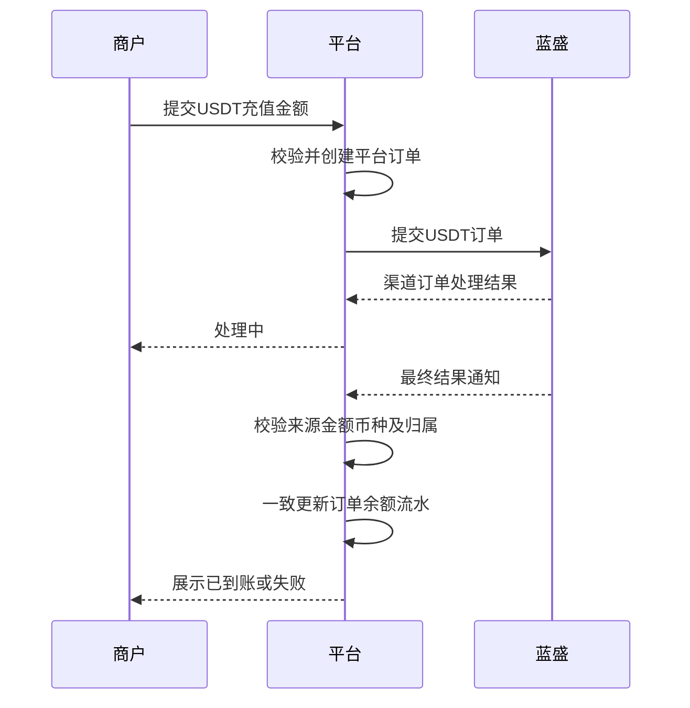

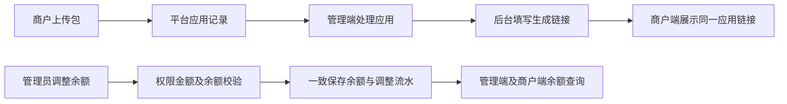

- 上图为正式目标；当前原型管理端与商户端应用、订单、余额未统一，生成链接后台录入尚未实现。
- 正式系统采用唯一平台订单及操作标识防止重复处理；渠道密钥和签名处理由后端完成。
- 当前套餐配置在同浏览器同站点共享；不同浏览器不是共享数据库。
- 静态网页没有真实认证、防护任务、自动扣款、回调接收服务或可用的真实APK存储。

## 附录 A7 权限与业务实体

### A7.1 权限矩阵（建议，待业务确认）

| 操作 | 商户 | 授权管理员 | 查询人员 |
|---|---|---|---|
| 上传及查看APP | 自身 | 授权范围 | 只读 |
| 添加生成链接 | 不允许 | 授权范围 | 不允许 |
| 提交充值 | 自身 | 不代替商户支付 | 不允许 |
| 手动余额调整 | 不允许 | 单独授权 | 不允许 |
| 读取阿里云敏感字段 | 待确认 | 单独授权并审计 | 默认不允许 |
| 改删历史资金流水 | 不允许 | 不允许 | 不允许 |

### A7.3 实体关系

```mermaid
erDiagram
 MERCHANT ||--o{ APP : owns
 APP ||--o| SERVICE : activates
 PLAN ||--o{ SERVICE : supplies_snapshot
 APP ||--o| GENERATED_LINK : exposes
 MERCHANT ||--|| BALANCE : owns
 MERCHANT ||--o{ RECHARGE_ORDER : creates
 RECHARGE_ORDER ||--o| PROVIDER_ORDER : maps
 RECHARGE_ORDER ||--o| LEDGER : credits
 MERCHANT ||--o{ ADJUSTMENT : receives
 ADMIN ||--o{ ADJUSTMENT : performs
 ADJUSTMENT ||--|| LEDGER : records
```

## 附录 A9 待确认与待实现清单

| 编号 | 事项 | 当前边界 |
|---|---|---|
| Q-01 | 蓝盛真实接口、签名、查单、通知及重试规则 | 未提供，不能声称已接入 |
| Q-02 | 蓝盛支付操作载体、手续费及差额规则 | 原型按提交USDT金额入账 |
| Q-03 | 管理端应用与商户上传记录统一、生成链接录入 | 未实现，需建立可靠应用归属映射 |
| Q-04 | 商户端和管理端余额、充值、手动调整统一 | 未实现；管理端订单仍为历史样例 |
| Q-05 | 套餐正式定价与周期 | 默认零价格与部分名称周期存在歧义，需配置确认 |
| Q-06 | 套餐开通扣款及流水、实际防护和流量消耗 | 原型未扣款、未执行 |
| Q-07 | 状态优先级、暂停恢复、过期及耗尽恢复 | 展示已支持，操作与真实状态源待接入 |
| Q-08 | 自动续费启用入口、时区、余额不足重试及永久套餐策略 | 只有规则弹窗 |
| Q-09 | 调整权限、停用商户政策、额度、审批及纠错 | 原型允许停用商户调整，无审批；反向调整纠错为建议 |
| Q-10 | 阿里云字段是否必填、谁能读写、保留和脱敏规则 | 原型选填，只应用模拟值 |
| Q-11 | 真实登录、安全绑定、密码联动与多账号隔离 | 未接入 |
| Q-12 | 上传限制、重复包、实际文件校验及发布下载 | 原型只校验名称扩展名和非空 |
| Q-13 | 性能、数据量、审计保留、分页导出及异常排查 | 正式指标待确认 |

## 附录 A10 原型选项与计算口径

- 开通费用仅为所选防护套餐价格；不配置、不选择、不计收流量包及渠道费用。
- 商户端套餐卡片移除APK分发、渠道包、多渠道、渠道统计等文案；总后台移除赠送流量、流量有效期、默认渠道数相关字段。
- 已存储的旧套餐权益按当前展示规则清理；历史服务金额保留，新开通记录只保存套餐信息和费用。
- 此次删除范围是套餐配置与相关展示，原先确认的五种任务状态（包括流量耗尽）保留；其业务来源仍需确认。

- 手动调整金额、充值金额和套餐价格上限属于当前原型规则，不自动视为正式额度审批。

## 附录 A11 资料与维护约定

- 合并来源：USDT充值PRD及附录、手动调整商户余额PRD及附录、当前原型与用户最近确认的变更。
- 参考：[短信聚合平台充值原型](/Users/luoluo/Documents/短信聚合平台/merchant.html)，只参考流程，币种以本项目USDT要求为准。
- 源码：[GitHub发布分支](https://github.com/bala-luoluo/M3/tree/codex/apksafe-admin-site)。
- 后续修改原型时同步维护本文件及验收状态；真实发布后再更新发布说明，不提前标记已上线。

## 下一步建议

- 先确认待实现的数据联通、蓝盛接口及真实权限，再开展生产功能开发和完整验收。
- 本文件作为统一PRD维护；旧分项文件保留历史参考，避免继续并行修改导致冲突。
