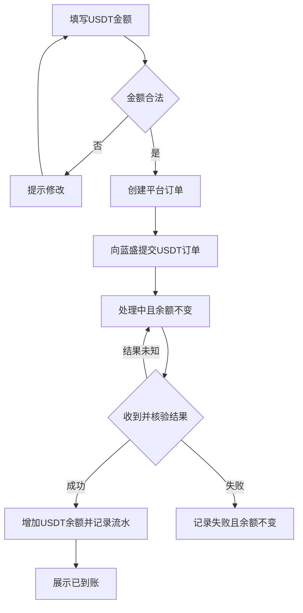
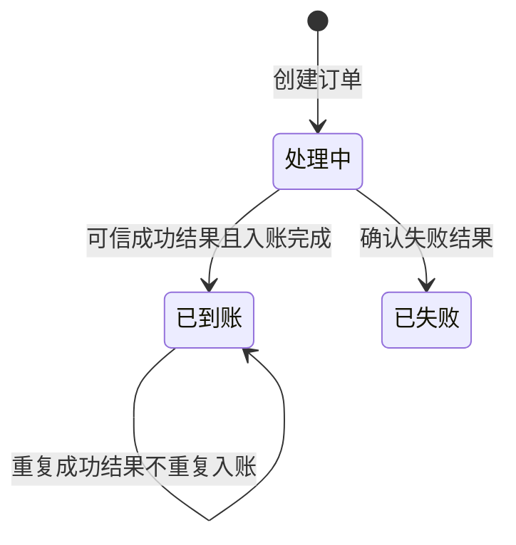
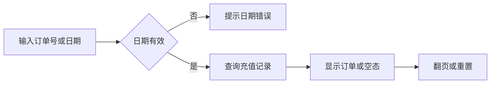
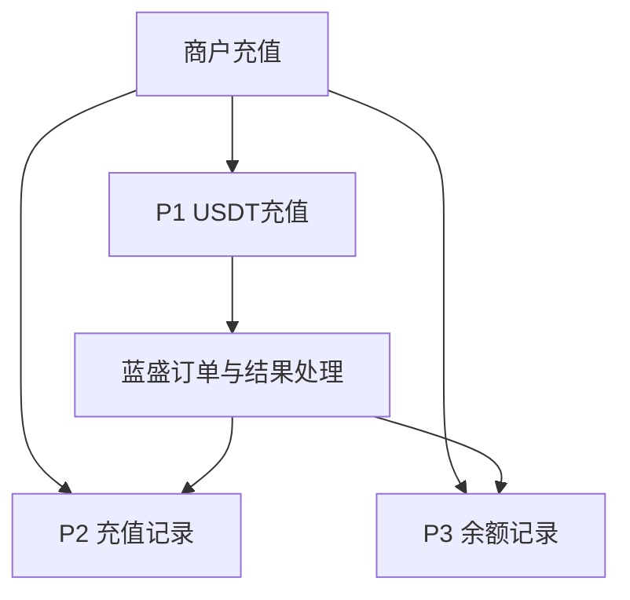

## 目录

- [[#§1 修订追踪表]]
- [[#§2 背景与目标]]
- [[#§3 功能清单]]
- [[#§4 功能细节规格]]
- [[#§5 功能流程图]]
- [[#§6 功能结构图]]
- [[#§7 页面设计]]
- [[#§8 Corner Case]]
- [[#§9 验收清单]]

## 本文件使用说明

- 本文对应当前商户端 USDT 充值原型；参考短信聚合平台的订单处理体验，币种以本项目要求为准。
- 向蓝盛提交的充值币种和到账币种均为 USDT，不进行人民币换算。
- 原型只模拟下单及结果通知；正式接口、通知校验、跨端同步尚未实现，不代表已真实接入蓝盛。
- 附录：[[PRD_USDT充值_2026-10-26_appendix]]。真实接口及待确认业务项见 A9。

## §1 修订追踪表

| 版本 | 日期 | 作者 | 说明 |
|---|---|---|---|
| V1 | 2026-10-26 | Codex | 初稿（未送审） |

## §2 背景与目标

- 商户需要通过平台发起 USDT 充值，平台向蓝盛请求订单，并根据可信的处理结果更新余额。
- 目标用户为商户；管理端运营人员需能查询订单和入账结果。
- 目标：提交与到账区分清晰；处理中不增加余额；成功只入账一次；充值和余额变动可核对。
- 本期范围：充值金额输入、订单处理中展示、成功及失败结果、充值记录、余额记录。
- 不在本期：人民币兑换、真实支付通道配置、人工补单、退款、对账导出。

## §3 功能清单

| 页面 | 变更 | 功能 | 结果 |
|---|---|---|---|
| P1 USDT充值 | [MOD] | 当前余额、金额提交、结果展示 | 获得平台订单并查看处理进度 |
| P2 充值记录 | [MOD] | 展示订单金额、状态及两侧币种 | 可核对每笔充值结果 |
| P3 余额记录 | [MOD] | 展示当前余额和成功充值流水 | 可核对入账前后余额 |

- 既有页面参考：[商户端在线原型](https://bala-luoluo.github.io/M3/merchant/index.html#/login)，本次充值改动尚未推送。

## §4 功能细节规格

### 4.1 P1 USDT充值

- UI：顶部展示当前账户余额，单位 USDT；填写充值金额并点击“创建充值订单”。
- 页面逻辑：金额必填、大于零、最多两位小数；单次最高 1,000,000 USDT，正式业务上限待确认。
- 页面逻辑：提交后显示平台订单号、金额、到账币种、创建时间和“处理中”；禁用同笔订单的重复提交入口。
- 业务处理：平台创建充值订单并向蓝盛提交 USDT 订单；只有收到并确认可信的成功结果后，才按平台订单金额增加 USDT 余额。
- 成功：显示“充值成功，已到账”和到账时间，可继续充值、查看充值记录或余额记录。
- 失败：显示“充值失败”，余额不变；再次充值创建新订单，不覆盖原失败订单。
- 正向流程：金额合法 → 提交订单 → 处理中 → 确认成功 → 入账与流水同时生效。
- 异常流程：非法金额不创建订单；结果不明确时继续处理中，不按等待时间推断成功。
- 边界：关闭页面或刷新后仍能查看订单；同一成功结果重复送达不得重复入账。
- 原型控制：折叠的“原型演示控制”提供模拟蓝盛成功、失败通知，仅用于验收演示，正式商户页面不得保留。
- 原型限制：没有真实收银台、支付跳转或网络请求；创建订单仅生成演示标识。

### 4.2 P2 充值记录

- UI：展示当前余额；保留订单号和创建时间筛选；列表展示会员、订单号、状态、输入金额、充值金额、创建时间、入账时间、充值币种、到账币种。
- 页面逻辑：两侧币种均显示 USDT；未到账订单不显示到账时间；支持重置和每页十条的翻页。
- 业务处理：提交订单即可留存充值记录；成功、失败等结果更新同一订单。
- 正向流程：提交后可找到订单，成功后可核对金额与入账时间。
- 异常流程：日期范围不合法时提示，保留原查询结果；无匹配数据时显示空态。
- 边界：处理中订单不应因用户查看记录而变成已到账；历史失败订单仍保留。

### 4.3 P3 余额记录

- UI：展示当前 USDT 余额，以及会员、类型、金额、流量、前余额、后余额、关联标识、描述、创建时间。
- 页面逻辑：按关联标识查询；每页十条；无结果时展示空态。
- 业务处理：只有成功充值生成入账流水；处理中、失败均不产生充值入账流水。
- 正向流程：成功后余额增加，流水保留入账前后余额及对应订单标识。
- 异常流程：失败不增加余额；正式系统保存异常时不得出现余额增加却没有流水的情况。
- 边界：重复成功通知只对应一条入账流水，不因刷新再次增加余额。

## §5 功能流程图

### 5.1 P1 充值订单流程

### 5.2 P2 充值记录查询

### 5.3 P3 余额记录查询

## §6 功能结构图

## §7 页面设计

| 页面 | 布局 | 主要动作 |
|---|---|---|
| P1 | 当前余额、金额输入、订单结果卡、原型控制 | 创建订单、继续充值、查看记录 |
| P2 | 当前余额、筛选、订单表格、分页 | 查询、重置、翻页 |
| P3 | 当前余额、标识查询、余额表格、分页 | 查询、翻页 |

- 原型入口：[本地USDT充值](http://127.0.0.1:4187/index.html#/preview/USDT充值)。
- 商户页面展示“系统自动处理”，蓝盛处理细节仅放在演示控制或管理端排查信息中。
- 不再要求商户自行填写收款地址；真实支付操作载体需根据蓝盛文档确认。

## §8 Corner Case

| 编号 | 场景 | 处理 |
|---|---|---|
| CC-01 | 空金额、零、负数、非数字、超过两位小数、超上限 | 不创建订单 |
| CC-02 | 重复点击提交 | 同笔提交只创建一次订单 |
| CC-03 | 蓝盛请求超时或无终态 | 保留订单等待查询，不自动入账 |
| CC-04 | 重复成功通知 | 不重复入账、不重复生成流水 |
| CC-05 | 币种、金额、订单归属不匹配 | 正式系统拦截并进入排查，不自动入账 |
| CC-06 | 关闭页面或刷新 | 保留处理结果及未完成订单 |
| CC-07 | 失败后重新充值 | 创建新订单，保留旧记录 |
| CC-08 | 保存余额或流水失败 | 不允许部分入账 |
| CC-09 | 成功与失败通知乱序 | 不回退已到账结果，冲突交由排查 |
| CC-10 | 历史待支付或已取消记录 | 保留历史记录，不批量改写历史资金结果 |

## §9 验收清单

### 9.1 功能验收

| 编号 | 页面 | 判定标准 |
|---|---|---|
| AC-01 | P1 | 提交10.50，订单金额显示10.50 USDT，到账币种为USDT |
| AC-02 | P1 | 订单处理中时，当前余额与提交前完全一致 |
| AC-03 | P1 | 成功结果使余额仅增加10.50，显示到账时间 |
| AC-04 | P1 | 失败结果不改变余额，并可重新创建订单 |
| AC-05 | P2 | 列表可找到订单，两侧币种均为USDT，成功前到账时间为空 |
| AC-06 | P2 | 订单号及日期筛选、重置、十条分页按所选条件展示 |
| AC-07 | P3 | 成功只产生一条关联订单的流水，前后余额正确 |
| AC-08 | P3 | 查询标识与翻页正确，无数据展示空态 |

### 9.2 非功能性验收

- 正式系统要求见附录 A4，须验证通知来源、重复请求、并发与数据隔离。
- 真实接口尚未接入；不能用模拟按钮验证结果替代生产验收。

### 9.3 边界验收

- AC-09：CC-01 各类非法金额均不创建订单。
- AC-10：连续点击及重复成功通知均不重复入账。
- AC-11：关闭刷新后可查原订单，未知结果不自动转成功。
- AC-12：币种、金额、归属异常均不能改变余额。
- AC-13：失败重试创建不同订单，旧失败记录仍可查。
- AC-14：保存异常、乱序通知不造成余额与流水不一致。

### 9.4 专项验收

- 接口验收：蓝盛下单金额、币种和平台订单一致；可信成功通知后按订单USDT金额入账。
- 当前完成：原型流程和记录字段已修改，JavaScript语法检查通过。
- 待完成：本次浏览器端完整回归、真实下单及通知联调、并发及重复请求测试、管理端订单同步。
- 签收规则：全部适用验收项通过，并明确附录 A9 的上线依赖后方可上线。

## 下一步建议

- 确认蓝盛接口文档、支付操作载体与入账金额规则，再开展真实服务对接。
- 原型后续变动同步更新本文件、验收状态及发布记录。
