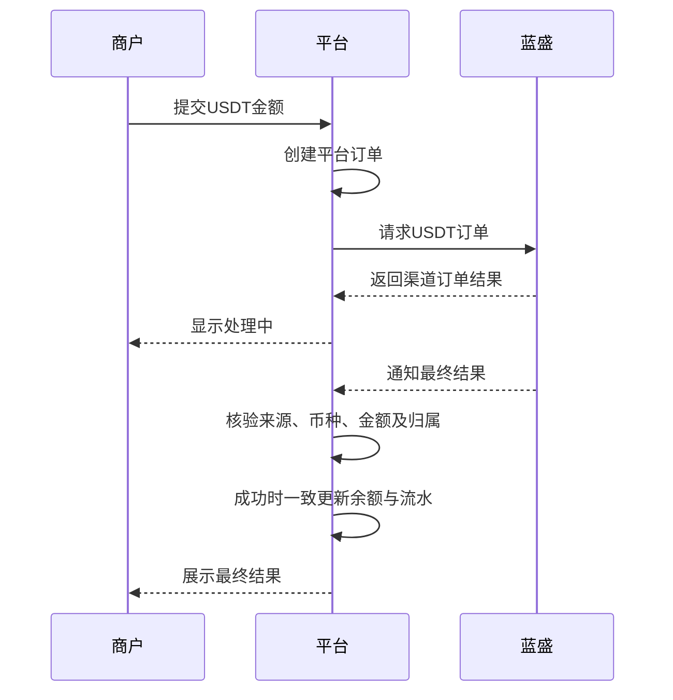
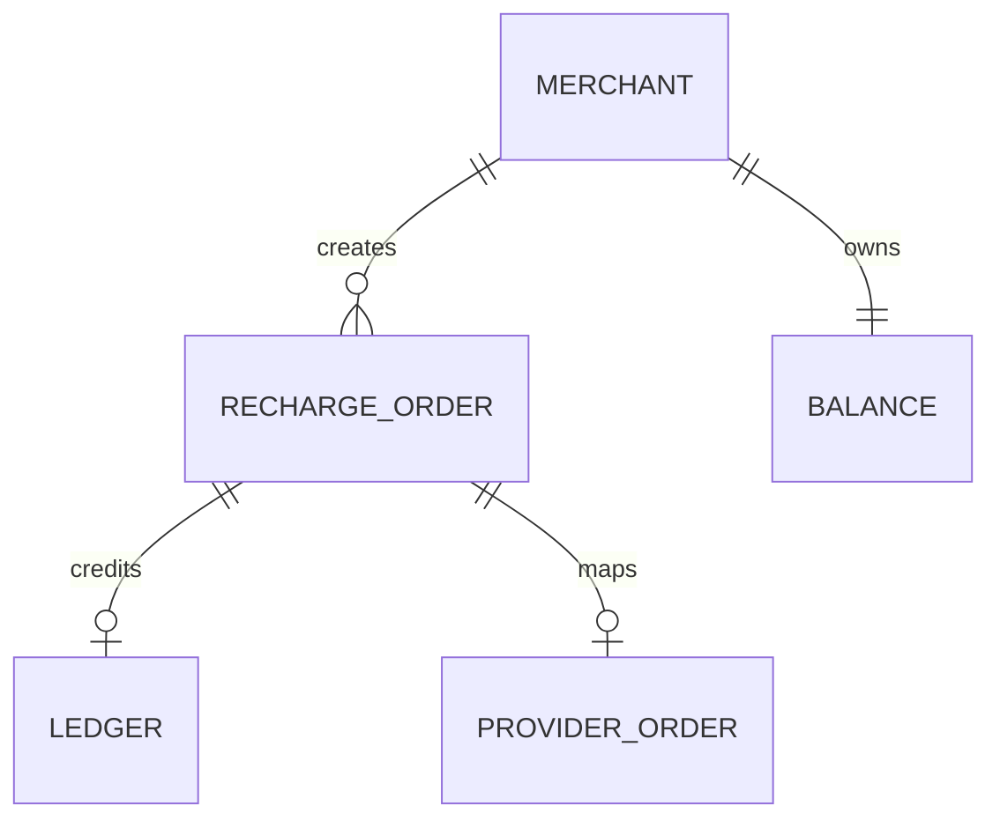

主文档：[[PRD_USDT充值_2026-10-26]]。

## A2 用户与角色

| 角色 | 职责 |
|---|---|
| 商户 | 提交自身充值、查询自身订单和余额 |
| 平台运营 | 在授权范围排查订单与结果 |
| 蓝盛 | 接收订单并返回处理结果 |

## A3 数据流与接入边界

- 原型用本地记录和模拟通知代替真实渠道请求；演示渠道单号不是真实蓝盛订单。
- 正式系统由后端保存渠道凭据、签名并验证通知，前端不得根据本地按钮直接入账。
- 当前管理端与商户端模拟数据独立；本次没有实现管理端订单同步。
- 待蓝盛文档确认订单创建、查询、通知验签、应答及补偿协议，不预设真实接口地址。

## A4 非功能性要求（正式系统）

- 同一平台订单最多入账一次；查询和通知结果不能重复改变余额。
- 订单成功、余额增加、流水生成同成同败；并发处理不能丢失余额变化。
- 通知校验必须包含可信来源、平台订单、金额、USDT币种与商户归属。
- 商户只能查询自身订单和余额；渠道密钥不能出现在客户端。
- 超时或结果未知时先查单，不能直接重复下单或推断成功。
- 同步失败及通知冲突保留可追溯记录，进入人工排查。

## A7 B端专项

### A7.1 权限原则

- 商户可创建自身充值和查看自身结果，不能修改订单金额或标记成功。
- 运营人员按授权范围查询；人工入账不属于本期范围。

### A7.3 业务实体关系

## A9 待确认事项

| 事项 | 当前状态 |
|---|---|
| 蓝盛下单、查单及通知文档 | 未提供 |
| 实际支付操作：收银台、地址或其他载体 | 未确认，原型仅展示系统处理 |
| 费用是否另收、是否存在到账差额 | 原型按提交金额入账；正式政策待确认 |
| 下单失败、请求超时、结果冲突处理 | 正式策略需结合接口约定 |
| USDT金额精度与单次限额 | 原型两位小数、最高1,000,000；正式标准待确认 |
| 管理端订单与商户余额联通 | 未实现 |
| 多账号数据隔离与真实认证 | 本地原型不具备正式隔离能力 |
