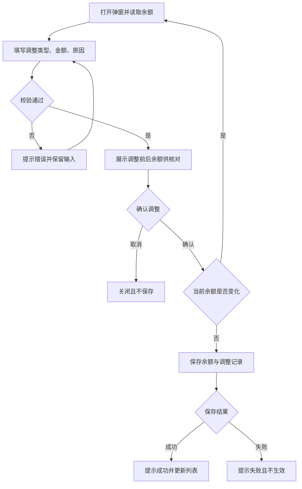
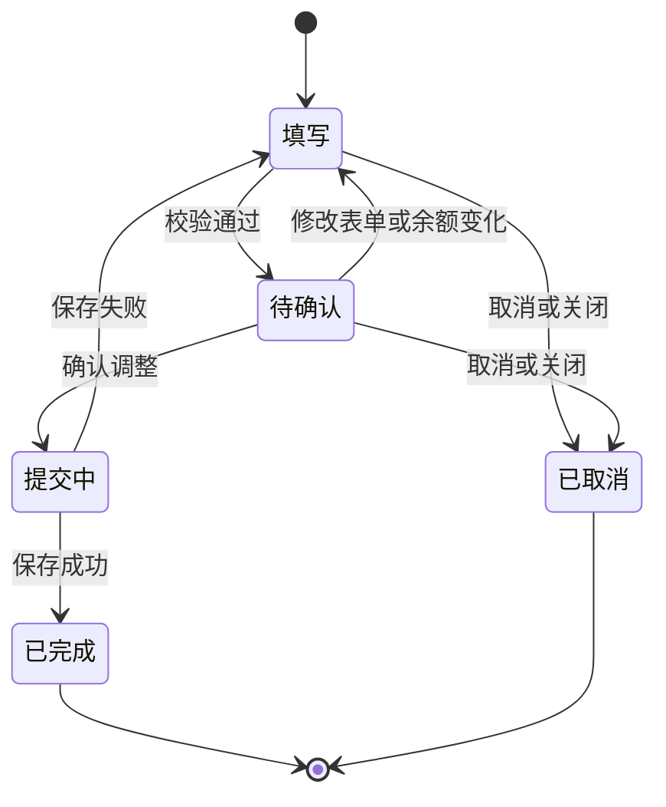
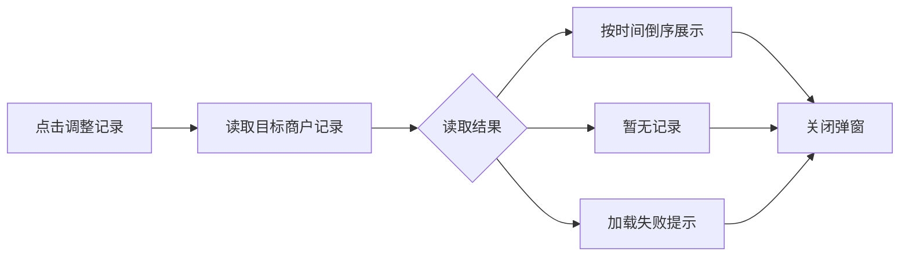
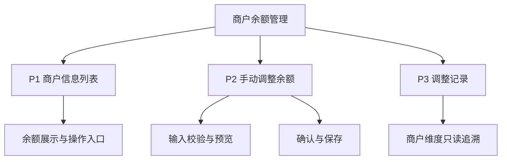

## 目录

- [[#§1 修订追踪表]]
- [[#§2 背景与目标]]
- [[#§3 功能清单]]
- [[#§4 功能细节规格]]
- [[#§5 功能流程图]]
- [[#§6 功能结构图]]
- [[#§7 页面设计]]
- [[#§8 Corner Case]]
- [[#§9 验收清单]]

## 本文件使用说明

- 范围：本次新增的管理端“手动调整商户余额”，不覆盖完整 APK 防护平台。
- 已实现内容以本地原型为依据；正式系统要求及尚未确定事项明确标注为建议或待确认。
- 附录：[[PRD_手动调整商户余额_2026-10-26_appendix]]，包含角色权限、数据流、非功能需求及待确认事项。
- 本地原型已支持余额调整；GitHub 在线版尚未更新该功能。

## §1 修订追踪表

| 版本 | 日期 | 作者 | 说明 |
|---|---|---|---|
| V1 | 2026-10-26 | Codex | 初稿（未送审） |

## §2 背景与目标

- 背景：管理端已有商户信息和充值订单查询，需支持管理员对指定商户进行余额增加或扣减。
- 目标用户：负责商户资金维护的授权管理员。
- 目标：调整对象清晰、金额可核对、原因可追溯，杜绝余额被扣成负数。
- 本期范围：调整入口、调整表单、二次确认、结果反馈、调整记录。
- 不在本期：真实充值到账、退款转账、批量调整、自动冲正、审批工作流。
- 当前原型：仅操作浏览器内模拟商户数据，管理端与商户端余额尚未贯通；正式系统应展示同一商户的统一余额（建议）。

## §3 功能清单

| 页面 | 功能 | 变更类型 | 业务结果 |
|---|---|---|---|
| P1 商户信息列表 | 调整余额、调整记录入口；展示最新余额 | [MOD] | 从指定商户发起操作，完成后查看结果 |
| P2 手动调整商户余额弹窗 | 商户核对、增加或扣减、金额与原因、结果预览、二次确认 | [NEW] | 合法调整成功保存，失败不改余额 |
| P3 余额调整记录弹窗 | 按商户展示历史调整明细 | [NEW] | 可追溯时间、金额、原因、操作人及调整前后余额 |

- 既有页面参考：[管理端商户信息](https://bala-luoluo.github.io/M3/#merchants)。该在线版本不含本次新增功能。

## §4 功能细节规格

### 4.1 P1 商户信息列表

- UI：操作列新增“调整余额”和“调整记录”，保留编辑、详情与启停操作；余额单位为 USDT。
- 页面逻辑：每个入口绑定所在行商户；调整成功后更新当前列表，保留筛选条件与所在页。
- 业务处理：列表余额取当前商户的已生效余额；列表查询、查看记录均不改变资金。
- 正向：选中目标商户行 → 打开对应弹窗。
- 异常：商户不存在或无权操作时阻止调整，显示明确提示（正式系统要求）。
- 边界：无商户记录时展示空态，不提供无对象的余额调整入口。

### 4.2 P2 手动调整商户余额弹窗

- UI：展示商户名称、商户编号、登录账号、当前余额；商户身份与当前余额只读。
- UI：默认“增加余额”；允许切换“扣减余额”；调整金额与原因必填；展示调整后余额、取消和确定按钮。
- 页面逻辑：填写或修改金额、调整类型后更新结果预览；修改表单内容后撤销之前的确认状态。
- 页面逻辑：首次点击“确定”展示调整前余额、调整方向、金额和调整后余额；按钮变为“确认调整”。只有再次确认才保存。
- 页面逻辑：取消、关闭或按 Esc 退出时不保存；重新打开时重新读取余额。
- 金额规则：金额必须大于零，最多两位小数；单次最高 1,000,000 USDT。此上限沿用原型，正式额度待确认。
- 金额规则：禁止负数、零、非数字及超额扣减；允许扣减后余额恰好为零。
- 原因规则：不能为空或只有空格，最多 200 字；仅填写原因不会改变余额。
- 业务处理：成功时同时更新余额与生成调整记录；任一保存失败均不应出现只改余额或只记流水的结果（正式系统要求）。
- 业务处理：手动调整与充值订单分开，不创建充值订单，不更改既有充值订单状态。
- 正向：填写 → 预览 → 核对 → 确认 → 保存成功 → 关闭弹窗并刷新列表。
- 异常：金额或原因不合规时在弹窗提示并保留输入；保存失败提示重试，不展示成功。
- 边界：提交期间余额已变化时，要求重新核对最新余额；重复点击或重试不得重复调整（正式系统要求）。

### 4.3 P3 余额调整记录弹窗

- UI：顶部显示商户名称、编号与当前余额；列表展示时间、增加或扣减、带方向的金额、调整前余额、调整后余额、原因、操作人。
- 页面逻辑：仅显示当前商户记录，最新记录在前；支持关闭；无记录显示“暂无调整记录”。
- 业务处理：成功调整生成记录，失败或取消不生成；记录只读，不允许修改或删除历史原因、金额。
- 业务处理：正式系统记录实际管理员身份，原型固定显示“管理员（演示）”。
- 正向：打开记录 → 核对余额变动 → 关闭。
- 异常：加载失败时提示失败，不将失败表现为无记录（正式系统要求）。
- 边界：长原因完整可读；大量记录的分页方案待确认，当前原型使用表格滚动。

## §5 功能流程图

### 5.1 P1 商户操作入口

### 5.2 P2 调整与确认

### 5.3 P3 调整记录查看

## §6 功能结构图

## §7 页面设计

### 7.1 P1 商户信息列表

| 区域 | 展示与交互 |
|---|---|
| 筛选区 | 保留商户信息、状态筛选 |
| 列表区 | 保留现有信息与余额列 |
| 操作区 | 调整余额、调整记录、编辑、详情、启停；窄屏允许横向滚动 |

### 7.2 P2 手动调整商户余额

| 从上到下 | 展示与交互 |
|---|---|
| 标题栏 | 手动调整商户余额、关闭 |
| 商户信息区 | 名称、编号、登录账号、当前余额 |
| 输入区 | 调整类型、金额、原因 |
| 预览区 | 调整后余额；确认阶段突出调整前后余额及方向 |
| 错误区 | 显示当前未通过的校验或保存失败原因 |
| 底部 | 取消、确定；核对阶段显示“确认调整” |

### 7.3 P3 余额调整记录

| 区域 | 展示与交互 |
|---|---|
| 商户摘要 | 名称、编号、当前余额 |
| 明细表格 | 时间、类型、金额、前余额、后余额、原因、操作人 |
| 底部 | 关闭 |

- 交互参考：[本地管理端原型](http://127.0.0.1:4187/admin.html#merchants)。需要本地预览服务运行。

## §8 Corner Case

| 编号 | 场景 | 期望 |
|---|---|---|
| CC-01 | 金额为空、零、负数、非数字、三位小数 | 阻止进入确认阶段 |
| CC-02 | 扣减额大于余额 | 阻止提交，余额不变 |
| CC-03 | 扣减额等于余额 | 成功后余额为零 |
| CC-04 | 原因只有空格或超过上限 | 阻止提交或限制输入 |
| CC-05 | 确认阶段修改任意输入 | 回到待核对状态，不能直接沿用旧确认 |
| CC-06 | 多人同时调整同一商户 | 以最新余额为准，避免覆盖已完成调整 |
| CC-07 | 连续点击确认、网络超时后重试 | 同一次调整最多生效一次 |
| CC-08 | 存储失败或服务异常 | 不出现余额与流水不一致 |
| CC-09 | 商户已停用 | 原型允许调整；正式策略待确认 |
| CC-10 | 无历史记录、长原因或大量历史 | 空态正确、内容可读，分页方案待确认 |
| CC-11 | 查看甲商户后切换乙商户 | 不展示或修改甲商户余额与流水 |

## §9 验收清单

### 9.1 功能验收

| 编号 | 页面 | 标准 |
|---|---|---|
| AC-01 | P1 | 每行存在两个新增入口，进入后商户编号与所在行一致 |
| AC-02 | P1 | 成功调整后列表余额立即更新，刷新后保持结果 |
| AC-03 | P2 | 余额为 100.00，增加 10.50 后显示并保存 110.50 |
| AC-04 | P2 | 余额为 100.00，扣减 10.50 后显示并保存 89.50 |
| AC-05 | P2 | 首次确定只进入核对阶段；再次确认后才生效 |
| AC-06 | P2 | 取消、关闭或 Esc 退出后余额和流水数量均不变 |
| AC-07 | P2 | 成功调整生成一条明细，不增加充值订单数量 |
| AC-08 | P3 | 明细中的前后余额、方向、金额与实际调整完全一致 |
| AC-09 | P3 | 仅显示目标商户记录，最新记录在最前，无记录时显示空态 |

### 9.2 非功能性验收

- 详见附录 A4：权限、保存一致性、重复提交、并发、记录追溯与数据隔离。
- 正式系统需独立验收服务端能力；本地原型通过不能替代上线验收。

### 9.3 边界验收

| 编号 | 关联场景 | 标准 |
|---|---|---|
| AC-10 | CC-01、CC-04 | 输入每种非法值均不能生成调整流水 |
| AC-11 | CC-02、CC-03 | 超额扣减失败；等额扣减成功且余额为零 |
| AC-12 | CC-05 | 修改确认中的金额后必须重新核对 |
| AC-13 | CC-06 | 另一管理员先完成调整后，旧余额上的提交不能覆盖新余额 |
| AC-14 | CC-07 | 连续提交及超时重试均只产生一次余额变更和一条流水 |
| AC-15 | CC-08 | 模拟保存失败后，不存在仅余额变化或仅生成流水的情况 |
| AC-16 | CC-10、CC-11 | 空态、长原因、跨商户切换展示正确且不串数据 |

### 9.4 B端专项验收

- 无调整权限的人员不能通过页面或绕过页面执行余额调整。
- 正式流水记录实际操作人，记录不可由普通管理员修改或删除。
- 管理端与商户端展示同一商户的最新余额，不影响其他商户（待正式联通后验收）。
- 已完成原型验证：增加 10.50、刷新保留、超额扣减拦截、扣减 10.50 至零、生成两条前后余额正确的记录。
- 尚未验证：真实权限、跨管理员并发、重复请求、服务端一致性、商户端联通。
- 签收规则：全部适用验收项通过，且附录 A9 的上线前问题确认后方可上线。

## 下一步建议

- 确认调整权限、单次额度、停用商户政策以及是否需要审批。
- 实现服务端余额和流水一致性，并联通商户端余额展示后执行上线验收。
