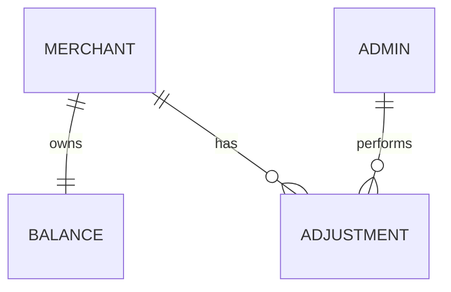

主文档：[[PRD_手动调整商户余额_2026-10-26]]。

## A2 目标用户与角色

| 角色 | 目标 | 说明 |
|---|---|---|
| 授权余额管理员 | 增加、扣减商户余额 | 正式角色归属待确认 |
| 查询人员 | 查看商户余额及调整记录 | 查询范围待确认 |
| 商户 | 查看自身当前余额及变动 | 正式联通要求，原型未实现 |

## A3 数据流与系统串接

- 正式系统建议：由服务端校验权限、金额、最新余额；余额更新与流水写入必须同成同败。
- 为同一次提交分配唯一操作标识，重试返回既有结果，避免重复入账或扣减。
- 原型：浏览器本地保存模拟数据；提交前比较余额可识别部分陈旧输入，但不具备真实并发控制与服务端认证。
- 当前管理端和商户端使用独立模拟数据，正式接入时需以商户身份关联同一余额来源。

## A4 非功能性需求

| 主题 | 正式系统验收要求 |
|---|---|
| 权限 | 未授权人员不可执行调整；只读人员不可通过绕过界面调整 |
| 一致性 | 余额更新和调整流水同成同败 |
| 幂等 | 同一调整的重复请求不得重复变更余额 |
| 并发 | 同时处理相同商户的调整不得丢失变更或产生负余额 |
| 追溯 | 记录真实操作人、发生时间、商户、金额、前后余额与原因 |
| 记录保护 | 普通管理员不能修改或删除已生效流水 |
| 隔离 | 一个商户的调整不改变其他商户数据 |
| 金额精度 | 金额按最小货币单位准确处理，显示两位小数，无累计舍入误差 |
| 失败反馈 | 明确区分未提交、失败与结果待确认；未知结果先查询再重试 |
| 可用性 | 支持键盘操作；横向滚动可见完整列；长原因可完整阅读 |
| 性能 | 正式数据量、响应时间及容量指标待确认，不以原型性能作为生产承诺 |

## A7 B端专项

### A7.1 权限矩阵（建议）

| 操作 | 授权余额管理员 | 查询人员 | 商户 |
|---|---|---|---|
| 查看商户余额 | 授权范围 | 授权范围 | 仅自身 |
| 手动调整余额 | 允许 | 不允许 | 不允许 |
| 查看调整记录 | 授权范围 | 授权范围 | 是否展示内部原因待确认 |
| 修改或删除历史调整 | 不允许 | 不允许 | 不允许 |

### A7.2 审计与纠错

- 已生效记录保持只读；调整错误时通过新的反向调整纠正，并填写关联说明（建议）。
- 是否增加复核审批、每日限额或大额审批待确认；当前原型只有操作者二次确认。

### A7.3 业务实体关系

- 商户：被调整对象。
- 余额：商户当前可用金额。
- 调整记录：一次成功变动的完整凭证。
- 管理员：执行调整的实际人员。

## A9 待确认事项

| 编号 | 问题 | 当前处理 | 确认方（建议） |
|---|---|---|---|
| Q-01 | 谁能调整、谁能查询，是否按商户范围授权 | 原型无真实权限 | 业务负责人 |
| Q-02 | 单次上限是否采用 1,000,000 USDT，是否有每日限额 | 沿用原型限制，未视为业务批准 | 业务及财务 |
| Q-03 | 是否允许调整停用商户 | 原型允许 | 业务负责人 |
| Q-04 | 是否需要双人复核或大额审批 | 当前不含审批 | 财务及业务负责人 |
| Q-05 | 商户端如何呈现调整原因、操作人 | 尚未联通；建议显示商户可见说明 | 产品及财务 |
| Q-06 | 流水保留期限、分页、筛选、导出要求 | 原型仅按商户查看及滚动 | 产品及运营 |
| Q-07 | 正式上线性能与响应指标 | 待确定业务容量 | 产品及研发 |

- Q-01 至 Q-05 应在正式上线前明确；其余需在实现与验收方案中补齐。
